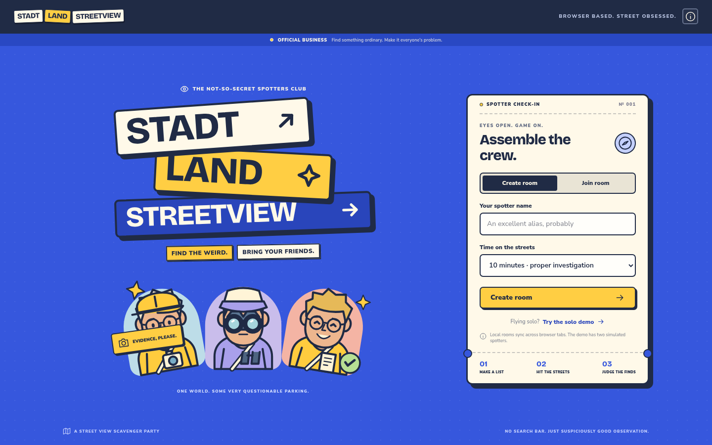
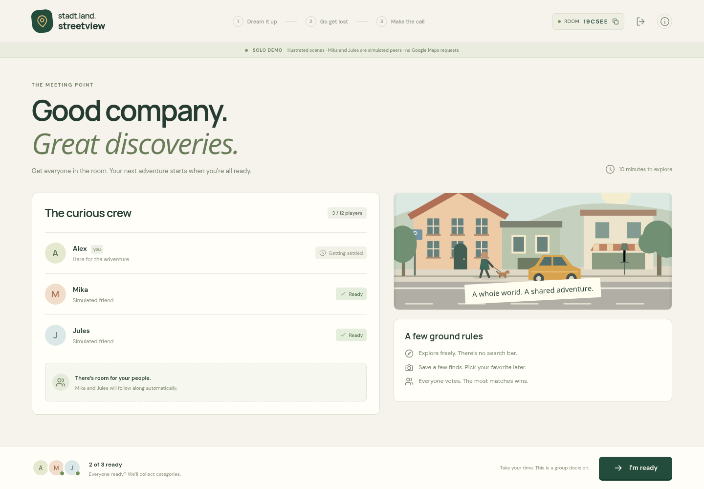
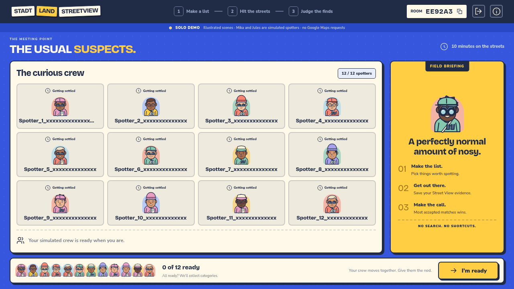
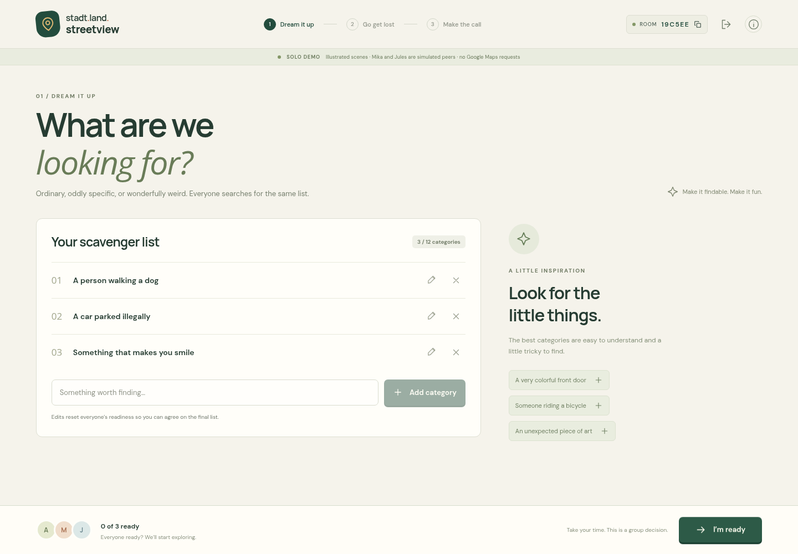
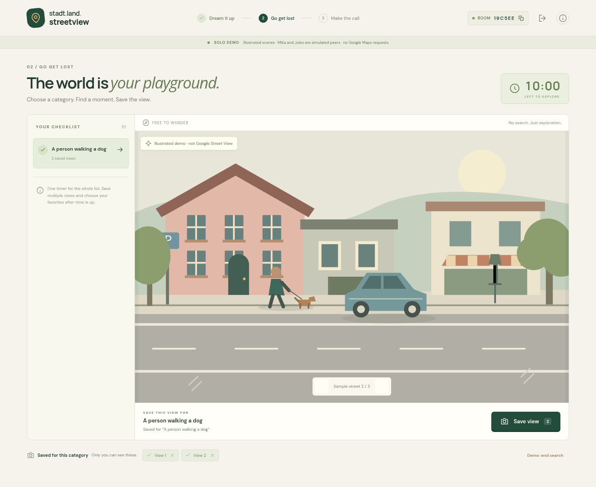
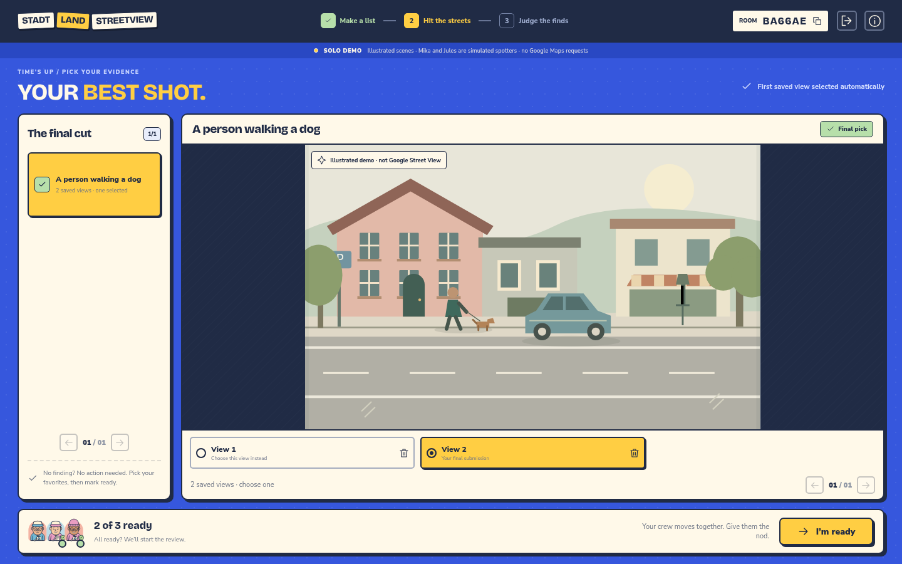
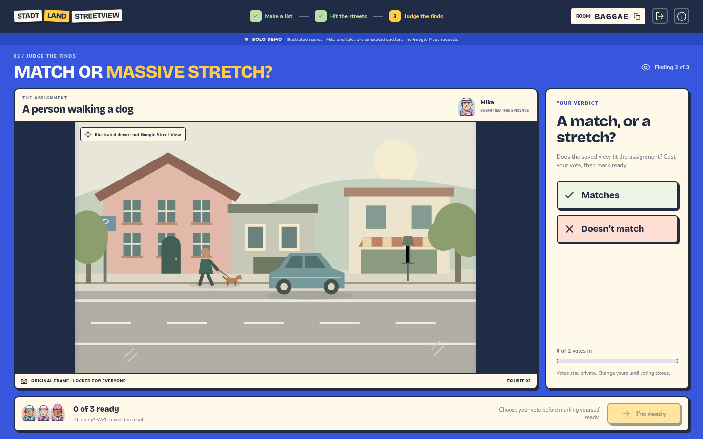
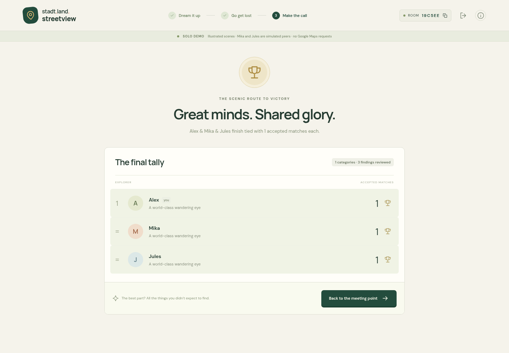

# UI design preview — the street spotters club

**Find the weird. Bring your friends.**

The identity is now a full-screen party game: misaligned street-sign lettering, electric-blue boards, traffic-yellow actions, asphalt outlines, and original generated SVG spotters. See the [brand notes](brand.md) for the visual system and character generation.

These are **actual viewport screenshots**, not long-page captures. The main images are 1440 × 900; the twelve-player example is 1280 × 720. Every phase fits the browser window without page or nested scrolling. Longer lists use explicit page controls.

The street scenes are **illustrated demo content**, not Google Street View imagery. Configured live rooms replace them with the interactive Google map and saved viewpoints. The same 16:10 frame is fitted to each workspace using deliberate letterboxing.

Click any screenshot to open it at full size.

## Check in

A bold game logo, a cast of suspiciously observant characters, and immediate create/join controls. The optional solo demo is available without a backend or Maps key.

## The usual suspects

Players get stable generated characters automatically. The crew switches to ready poses when they give the nod. Progression is peer-based, with no host controls or character reroll.

### Twelve spotters at 1280 × 720

The full crew fits in a bounded grid. This layout-test fixture also uses maximum-length player names.

## Make the list

Four assignments per page, shared editing, and suggestions from the field. Readiness resets when the list changes.

## Hit the streets

The timer, category rail, fixed-aspect map aperture, save action, and paginated private evidence strip are visible together.

## Pick your evidence

The camera preview keeps its framing. Candidates have explicit page controls; the first saved view is selected automatically and missing findings are skipped.

## Judge the finds

One server-controlled finding for everyone. The evidence stays locked while the crew votes. A vote automatically counts as ready; only the finding's owner has a ready button. The footer occupies its own space and never covers the view. The screenshot below predates this simplified voting flow.

Once everyone responds, the finding is scored and the next vote opens immediately. There is no separate verdict screen or second readiness step.

## Case closed

Spotter honors, a paginated scoreboard, and a way back to the meeting point. Tied leaders share the win.

---

Screenshots are captured by `frontend/tests/game.spec.ts`. The tests check viewport containment at 1280 × 720, 1440 × 900, and 1920 × 1080, including maximum-content fixtures and instruction dialogs. See the [setup guide](../frontend/README.md) to run the interactive demo, or the [API contract](api.md) for the Axum integration.
